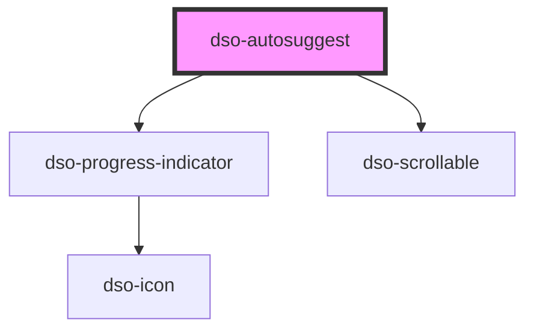

# `<dso-autosuggest>`

<!-- Auto Generated Below -->

## Properties

| Property         | Attribute         | Description                                                                                                                                                                                                                                                                                                                                                                                                                                                                                                                                                                     | Type                                                                                                                                                   | Default                |
| ---------------- | ----------------- | ------------------------------------------------------------------------------------------------------------------------------------------------------------------------------------------------------------------------------------------------------------------------------------------------------------------------------------------------------------------------------------------------------------------------------------------------------------------------------------------------------------------------------------------------------------------------------- | ------------------------------------------------------------------------------------------------------------------------------------------------------ | ---------------------- |
| `loading`        | `loading`         | Shows progress indicator when fetching results.                                                                                                                                                                                                                                                                                                                                                                                                                                                                                                                                 | `boolean`                                                                                                                                              | `false`                |
| `loadingDelayed` | `loading-delayed` | To delay progress indicator showing (in ms).                                                                                                                                                                                                                                                                                                                                                                                                                                                                                                                                    | `number \| undefined`                                                                                                                                  | `undefined`            |
| `loadingLabel`   | `loading-label`   | To override progress indicator's default loading label.                                                                                                                                                                                                                                                                                                                                                                                                                                                                                                                         | `string \| undefined`                                                                                                                                  | `"Een moment geduld."` |
| `mark`           | --                | A function provided by the consumer of the autosuggest component, that returns an array of `AutosuggestMarkItem`s                                                                                                                                                                                                                                                                                                                                                                                                                                                               | `((suggestion: Suggestion, text: string, type: "value" \| "type" \| "extra", extraIndex?: number \| undefined) => AutosuggestMarkItem[]) \| undefined` | `undefined`            |
| `notFoundLabel`  | `not-found-label` | To show text when no results are found.                                                                                                                                                                                                                                                                                                                                                                                                                                                                                                                                         | `string \| undefined`                                                                                                                                  | `undefined`            |
| `suggestions`    | --                | The suggestions for the value of the slotted input element.  This can be an array of type Suggestion or an Array of type SuggestionGroup.  A suggestionGroup must have a `groupLabel` and `suggestions`.  A suggestion must have a `value` and can have a `type`, an `item` or `extras`.  The `type` is used to style the suggestion. `item` can be use to reference the original object that was used to create the suggestion. `extras` is an array of additional strings to further specify the suggestion.  The value should be null when no suggestions have been fetched. | `SuggestionGroup[] \| Suggestion[] \| null`                                                                                                            | `null`                 |

## Events

| Event       | Description                                                                                                             | Type                      |
| ----------- | ----------------------------------------------------------------------------------------------------------------------- | ------------------------- |
| `dsoChange` | This is emitted debounced for every change for the slotted input type=text element.                                     | `CustomEvent<string>`     |
| `dsoSearch` | Emitted when enter is pressed. The `detail` property of the `CustomEvent` will contain the input text.                  | `CustomEvent<string>`     |
| `dsoSelect` | Emitted when a suggestion is selected. The `detail` property of the `CustomEvent` will contain the selected suggestion. | `CustomEvent<Suggestion>` |

## Slots

| Slot | Description                                                      |
| ---- | ---------------------------------------------------------------- |
|      | The input element to be enhanced with autosuggest functionality. |

## Dependencies

### Depends on

- [dso-progress-indicator](../progress-indicator)
- [dso-scrollable](../scrollable)

### Graph

----------------------------------------------

*Built with [StencilJS](https://stenciljs.com/)*
