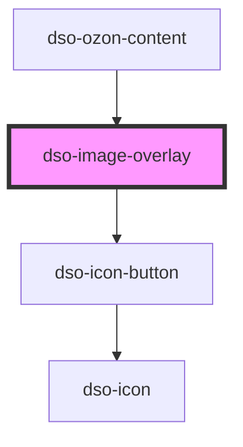

# `<dso-image-overlay>`

<!-- Auto Generated Below -->

## Properties

| Property      | Attribute     | Description      | Type                  | Default     |
| ------------- | ------------- | ---------------- | --------------------- | ----------- |
| `wijzigactie` | `wijzigactie` | The wijzigactie. | `string \| undefined` | `undefined` |

## Slots

| Slot           | Description                                                                 |
| -------------- | --------------------------------------------------------------------------- |
|                | A slot to place the target `` element in to make it zoomable.          |
| `"bijschrift"` | An optional slot to place a caption in, displayed inside the modal overlay. |
| `"titel"`      | An optional slot to place a title in, displayed inside the modal overlay.   |

## Dependencies

### Used by

 - [dso-ozon-content](../ozon-content)

### Depends on

- [dso-icon-button](../icon-button)

### Graph

----------------------------------------------

*Built with [StencilJS](https://stenciljs.com/)*
