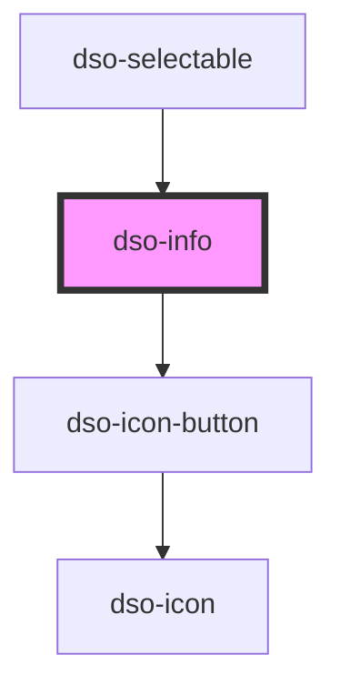

# `<dso-info>`

<!-- Auto Generated Below -->

## Properties

| Property     | Attribute     | Description                                                                                                                   | Type                   | Default     |
| ------------ | ------------- | ----------------------------------------------------------------------------------------------------------------------------- | ---------------------- | ----------- |
| `active`     | `active`      | Whether the Info is active.                                                                                                   | `boolean \| undefined` | `undefined` |
| `closeLabel` | `close-label` | The accessible label of the close button. Make this specific, for example `Sluit toelichting [label]`. Defaults to "Sluiten". | `string \| undefined`  | `undefined` |
| `fixed`      | `fixed`       | Set to true if the Info should not be toggled and always visible.                                                             | `boolean \| undefined` | `undefined` |

## Events

| Event      | Description                                                                                                                                                                                | Type                          |
| ---------- | ------------------------------------------------------------------------------------------------------------------------------------------------------------------------------------------ | ----------------------------- |
| `dsoClose` | Emitted when the user activates the close button.  `previousActiveElement` contains the element that had focus when the Info was activated. Use it to return focus after closing the Info. | `CustomEvent<InfoCloseEvent>` |

## Slots

| Slot | Description                                      |
| ---- | ------------------------------------------------ |
|      | The content to be displayed inside the info box. |

## Dependencies

### Used by

 - [dso-selectable](../selectable)

### Depends on

- [dso-icon-button](../icon-button)

### Graph

----------------------------------------------

*Built with [StencilJS](https://stenciljs.com/)*
