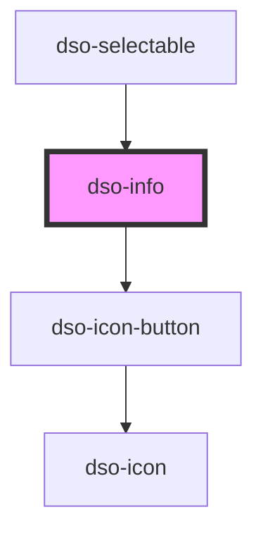

# `<dso-info>`

## Close button label

The close button has the label "Sluiten" by default. Use `closeLabel` to make it specific for the context, for example
"Sluit toelichting" followed by the label of
the question or option.

## Focus management

When the Info is closed with the close button, the close button disappears and focus is lost. The consumer is responsible
for returning focus, usually to the Info Button that opened the Info.

When the Info becomes active, it stores the element that had focus at that moment. This element is passed as
`previousActiveElement` in the `dsoClose` event:

```typescript
info.addEventListener("dsoClose", (e: DsoInfoCustomEvent<InfoCloseEvent>) => {
  info.active = false;

  e.detail.previousActiveElement?.focus();
});
```

If the Info is opened in another way than by the Info Button, use `setFocus()` on `<dso-info-button>` instead.

<!-- Auto Generated Below -->


## Properties

| Property     | Attribute     | Description                                                                                                                   | Type                   | Default     |
| ------------ | ------------- | ----------------------------------------------------------------------------------------------------------------------------- | ---------------------- | ----------- |
| `active`     | `active`      | Whether the Info is active.                                                                                                   | `boolean \| undefined` | `undefined` |
| `closeLabel` | `close-label` | The accessible label of the close button. Make this specific, for example `Sluit toelichting [label]`. Defaults to "Sluiten". | `string \| undefined`  | `undefined` |
| `fixed`      | `fixed`       | Set to true if the Info should not be toggled and always visible.                                                             | `boolean \| undefined` | `undefined` |


## Events

| Event      | Description                                                                                                                                                                                | Type                          |
| ---------- | ------------------------------------------------------------------------------------------------------------------------------------------------------------------------------------------ | ----------------------------- |
| `dsoClose` | Emitted when the user activates the close button.  `previousActiveElement` contains the element that had focus when the Info was activated. Use it to return focus after closing the Info. | `CustomEvent<InfoCloseEvent>` |


## Slots

| Slot | Description                                      |
| ---- | ------------------------------------------------ |
|      | The content to be displayed inside the info box. |


## Dependencies

### Used by

 - [dso-selectable](../selectable)

### Depends on

- [dso-icon-button](../icon-button)

### Graph


----------------------------------------------

*Built with [StencilJS](https://stenciljs.com/)*
