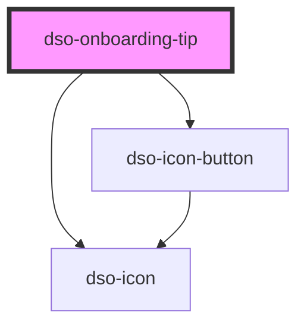

# `<dso-onboarding-tip>`

<!-- Auto Generated Below -->

## Properties

| Property    | Attribute   | Description                                                          | Type                                     | Default   |
| ----------- | ----------- | -------------------------------------------------------------------- | ---------------------------------------- | --------- |
| `placement` | `placement` | Where to place the Onboarding Tip relative to its reference element. | `"bottom" \| "left" \| "right" \| "top"` | `"right"` |

## Events

| Event      | Description                                      | Type                                   |
| ---------- | ------------------------------------------------ | -------------------------------------- |
| `dsoClose` | Emitted when the user closes the Onboarding Tip. | `CustomEvent<OnboardingTipCloseEvent>` |

## Slots

| Slot        | Description                                        |
| ----------- | -------------------------------------------------- |
|             | A slot for the main content of the onboarding tip. |
| `"heading"` | A slot for the heading of the onboarding tip.      |

## Dependencies

### Depends on

- [dso-icon](../icon)
- [dso-icon-button](../icon-button)

### Graph

----------------------------------------------

*Built with [StencilJS](https://stenciljs.com/)*
