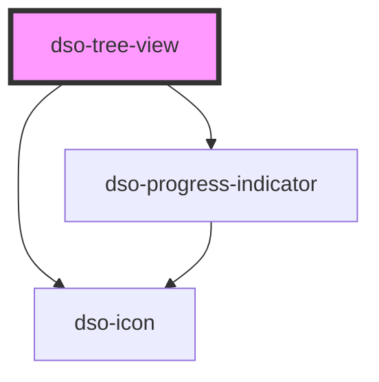

# `<dso-tree-view>`

<!-- Auto Generated Below -->

## Properties

| Property                  | Attribute | Description                     | Type             | Default     |
| ------------------------- | --------- | ------------------------------- | ---------------- | ----------- |
| `collection` _(required)_ | --        | The collection of TreeViewItems | `TreeViewItem[]` | `undefined` |

## Events

| Event          | Description                                                                                                                                                                                                                                                                                                                                                                                                                                                     | Type                                |
| -------------- | --------------------------------------------------------------------------------------------------------------------------------------------------------------------------------------------------------------------------------------------------------------------------------------------------------------------------------------------------------------------------------------------------------------------------------------------------------------- | ----------------------------------- |
| `dsoClickItem` | Emitted when a tree view item is clicked. The `detail` property of the `CustomEvent` will contain an object with: `path` = the complete path of TreeViewItems from the root to the item that is emitting the clicked event. `originalEvent` = the original click event. The consumer of the event is responsible for updating the TreeView's collection (usually set the active state on the last TreeViewItem in path and clear all other active item states). | `CustomEvent<TreeViewPointerEvent>` |
| `dsoCloseItem` | Emitted when a tree view item is closed. The `detail` property of the `CustomEvent` will contain the complete path of TreeViewItems from the root to the item that is emitting the close event. The consumer of the event is responsible for updating the TreeView's collection (usually set the closed state on the last TreeViewItem in path).                                                                                                                | `CustomEvent<TreeViewItem[]>`       |
| `dsoOpenItem`  | Emitted when a tree view item is opened. The `detail` property of the `CustomEvent` will contain the complete path of TreeViewItems from the root to the item that is emitting the open event. The consumer of the event is responsible for updating the TreeView's collection (usually set the open state on the last TreeViewItem in path).                                                                                                                   | `CustomEvent<TreeViewItem[]>`       |

## Methods

### `focusItem(path: TreeViewItem[]) => Promise<boolean>`

Set focus on the last item in the specified path.
The consumer is responsible for providing a TreeView collection where the last item is visible.

#### Parameters

| Name   | Type             | Description |
| ------ | ---------------- | ----------- |
| `path` | `TreeViewItem[]` |             |

#### Returns

Type: `Promise<boolean>`

Whether the item was found.

## Dependencies

### Depends on

- [dso-icon](../icon)
- [dso-progress-indicator](../progress-indicator)

### Graph

----------------------------------------------

*Built with [StencilJS](https://stenciljs.com/)*
