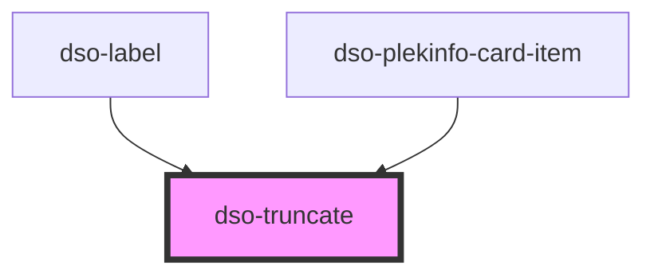

# `<dso-truncate>`

<!-- Auto Generated Below -->

## Slots

| Slot | Description          |
| ---- | -------------------- |
|      | Content to truncate. |

## Dependencies

### Used by

 - [dso-label](../label)
 - [dso-plekinfo-card-item](../plekinfo-card/plekinfo-card-item)

### Graph

----------------------------------------------

*Built with [StencilJS](https://stenciljs.com/)*
